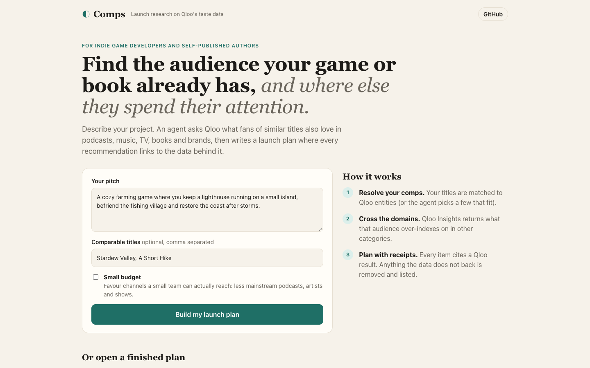
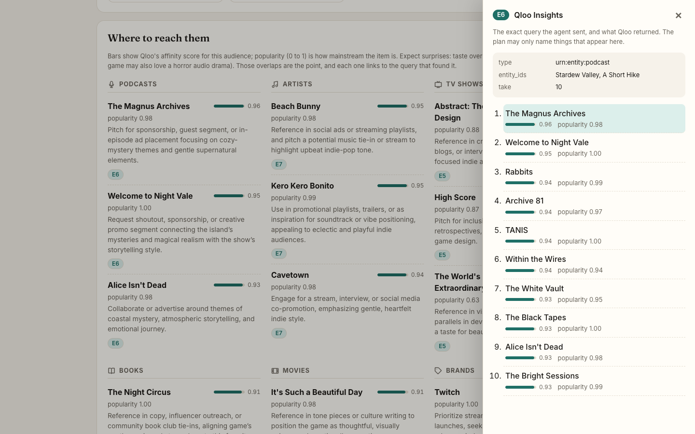

# Comps

**Launch research for indie game developers and self-published authors, built on Qloo's taste data.**

You describe your game or book and, optionally, a few titles it feels like. Comps works out who that audience is and where else they spend their attention (podcasts, artists, TV shows, brands, books), then turns it into a launch plan. Every recommendation links to the Qloo result it came from. The names in the plan come from Qloo; the prose around them (why, what to do, the audience summary) is written by the model from that evidence, and free-form ideas such as taglines sit in a separate section labelled as interpretation.

## 1. The problem

Indie creators rarely know who their audience is beyond "people who like games like mine". Publishers answer this with "comps" (comparable titles) and paid audience research; a solo developer or self-published author usually guesses, then spends a small marketing budget in the wrong places. The question they actually need answered is cross-domain: *people who love Stardew Valley — which podcasts do they listen to, which artists, which shows?* That is what Qloo's taste graph models.

## 2. Qloo workflows used, and why

| Tool the agent calls | Qloo endpoint | Why |
|---|---|---|
| `qloo_search` | `GET /search` | Resolve the creator's comps (and comps the agent proposes) to Qloo entity IDs. |
| `qloo_insights` | `GET /v2/insights` with `filter.type` + `signal.interests.entities` / `signal.interests.tags` | The core step: what the comps' audience also likes in **other** entity types (podcast, artist, tv_show, brand, book, movie). |
| `qloo_tags` | `GET /v2/tags` | Turn a theme from the pitch ("cozy", "roguelike") into a tag signal. |

The agent (OpenAI gpt-4.1 with function calling, raw HTTP in `server/openai.ts`) decides which comps and domains to query, notices empty results and tries another comp or domain instead of guessing.

**Provenance by construction.** Every Qloo call is stored server-side as an evidence record (E1, E2, …). The report is written as structured output where each comp, channel and positioning point must cite evidence IDs, and the server then checks each item against the evidence (`checkReport` in `server/agent.ts`):

- a **channel** must be an entity returned by an Insights query for that same domain (a podcast must come from a podcast query);
- a **comp** must come from an Insights query seeded by the comps' entities, or be a title the creator typed (a search hit alone only proves a title exists);
- a **positioning point** must name an entity or tag that appears in the evidence.

Items that fail are **dropped** and listed at the end of the plan. When the name is in the data but the model cited the wrong record, the citation is **corrected** to the record that contains it, and the plan says how many were corrected. Citations that are not evidence ids are removed. Clicking an evidence chip shows the exact Qloo query and results behind a recommendation.

## 3. Request → result walkthrough (redacted)

From the "Cozy lighthouse farming game" sample (live API, 10 Qloo calls; entity IDs redacted to their type):

1. **Input.** Pitch: *"A cozy farming game where you keep a lighthouse running on a small island, befriend the fishing village and restore the coast after storms."* Comps typed by the creator: Stardew Valley, A Short Hike.
2. **Resolve comps.** `GET /search?query=Stardew Valley&types=urn:entity:videogame` → E1, and the same for A Short Hike → E2. The agent picks the matching `urn:entity:videogame` entity from each.
3. **Cross the domains.** Six calls to `GET /v2/insights` with `signal.interests.entities=<Stardew Valley id>,<A Short Hike id>` and `filter.type` set to `urn:entity:book`, `movie`, `tv_show`, `podcast`, `artist` and `brand` → E3 to E8.
4. **Add a theme.** `GET /v2/tags?filter.query=cozy` → E9, then an Insights call for videogames with that tag as the signal → E10.
5. **One result → one line.** The podcast query (E6) returns The Magnus Archives with affinity 0.96. The plan's podcast line reads *"The Magnus Archives: pitch for sponsorship or a guest segment …"* and cites E6. `checkReport` confirms the name is in E6 and that E6 is a podcast query, so the line stays. Clicking the E6 chip shows that query and its results.
6. **What the check removed.** The model also proposed Monument Valley as a comp, citing only the Stardew Valley search (which returns every game with "Valley" in the name), and NieR: Automata from the tag-only query. Neither came from an Insights query on the creator's comps, so both were dropped and listed at the end of the plan.

## 4. Demo

- Live demo: https://comps-three-pi.vercel.app. The landing page has finished sample plans you can open without waiting.
- Screenshots below. They contain no API keys or personal data.




## 5. Run it from a clean environment

Requirements: Node.js 22.18 or newer, an OpenAI API key, a Qloo hackathon API key.

```sh
git clone https://github.com/tsang326/comps.git && cd comps
npm ci --ignore-scripts
cp .env.example .env     # set OPENAI_API_KEY, QLOO_API_KEY, QLOO_MODE=live
npm start                # web on http://localhost:5173, API on :3001
npm test
```

Without a Qloo key, `QLOO_MODE=mock` runs everything on synthetic data whose names end in "(mock)", and the UI shows a banner saying so. A mock run produces a plan full of "(mock)" names: it is for testing the flow, not the output.

Sample plans for the landing page are generated with `scripts/make-sample.ts` against the live API and stored outside the repository (Upstash Redis when `KV_REST_API_URL`/`KV_REST_API_TOKEN` are set, otherwise `cache/`, which is gitignored), because Qloo response data must not be committed to a public repository.

## 6. Known limitations — what a result does not establish

- Qloo results describe what **groups** of people tend to like. They say nothing about what any individual will do, and an affinity is not a prediction of sales or conversions.
- Small indie titles may not exist in Qloo's graph; the plan then rests on larger comps the creator or agent picked, which skews toward a more mainstream audience.
- Sections labelled "interpretation" (e.g. tone, tagline ideas) are the model's suggestions, not Qloo data.
- No personal data is sent to Qloo: only titles, themes and entity IDs.
- The public demo caches results by input and has a small daily allowance of new runs (larger during judging, 2–16 Nov) plus a spend budget. When it is used up, the finished sample plans stay available.

## Data handling

API keys stay on the server and are never sent to the browser. Qloo responses are not stored in this repository. See Qloo's safe-use guidance in the hackathon kit.

## License

MIT
